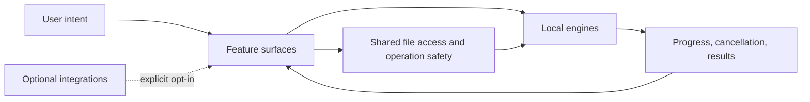

# XFinder — MFinder Reference Roadmap

**Purpose:** Turn the supplied MFinder feature prompts into a truthful, staged XFinder plan. MFinder is a reference for user outcomes, not an API or implementation authority. XFinder remains a native macOS utility; this plan does not commit the app to reproducing MFinder's cloud services, 7-Zip bundle, semantic model, or proprietary behaviors.

**Baseline inspected:** `a24bcb21c7ea03e3394b18604f9a3a09f1169889` (`main`); code and tests are unchanged since baseline `590e210` (the later commits are documentation-only). The current `StorageDetailView` uses `DiskManager` for volume capacity, I/O rates, and SMART status. This is a different responsibility from recursively analyzing a user-selected folder.

## Product map

The features group into four layers:

1. **Discover and understand:** File Browser, Spotlight search, Storage Analyzer, Duplicate Finder, OCR.
2. **Change files safely:** image/PDF tools, archive operations, batch rename, folder sync, secure container.
3. **Work with the desktop:** screenshot capture, window snapping, Cleaning Mode, Drop Tray.
4. **Observe the machine:** System Monitor and existing disk/volume health.

The shared layer should own scoped file access, progress/cancellation conventions, localization, and safe file operations. It should not become a generic mega-engine: each feature keeps a focused engine and state model, with shared utilities only where semantics truly match.

## Current XFinder coverage from source inspection

| MFinder capability | XFinder starting point | Gap / overlap | Direction |
|---|---|---|---|
| Disk Storage Analyzer | `DiskManager`, `StorageDetailView` show volume capacity and device I/O | No user-selected directory scan, size tree, or largest-items report. Volume bytes are not folder bytes. | Start with a cancellable, read-only folder scan. Add charts only after result semantics and performance are proven. |
| Duplicate Finder | No dedicated duplicate finder found | New feature; overlaps with storage traversal and safe Trash operations. | Reuse only a small traversal contract after it proves stable; exact byte comparison follows size/hash shortlist. |
| Archive Manager | `ArchiveEngine`, `ArchiveRunner` and archive UI; current implementation uses system tools such as `ditto`, `zip`, `tar` | Do not add a bundled 7zz binary without license, provenance, notarization, and update plan. Verify each format's extraction behavior. | Audit safety and coverage first; preserve no-overwrite and traversal protections. |
| Find in Files / AI search | `FileSearchEngine`, Quick Search and Spotlight-backed query paths | Natural-language parsing exists; no verified embedding/vector search API or semantic index. | Describe current behavior as parsed local Spotlight search. Do not claim AI semantic retrieval without a supported local engine and evidence. |
| Folder Sync | `FolderSyncController` has one-way rsync flow, optional `--delete`, change watching/schedule | No safe two-way reconciliation/preview contract. Optional delete raises data-loss risk. | Highest safety follow-up: preview exact source/destination changes, stale-preview detection, explicit delete policy, then consider two-way sync. |
| Screenshot + OCR | Capture controller, annotation, scroll capture, Vision OCR, configurable shortcuts | Existing work covers much of the prompt. System shortcut interception remains permission- and OS-sensitive; defaults preserve macOS shortcuts. | Fix reported bugs in-place; measure first-use OCR latency; do not intercept reserved shortcuts by default. |
| Drop Tray | Existing local clipboard/file tray surfaces | Cloud/cross-device sharing is not an inherent part of local tray behavior. | Keep local staging distinct from optional sharing; no auto-upload. |
| Secure Lock | `BoardLock` protects clipboard boards | Not an encrypted folder container. Reusing its name/state would mislead users. | Defer custom vault until threat model, crypto format, recovery, temp-file lifecycle, and independent security review exist. |
| System Monitor | `SystemMonitorManager`, `DiskManager`, thermal/power/GPU helpers | Broad device metrics already exist; per-process network accounting is not established. | Consolidate metric readers only if duplicate polling is measured. Never invent per-app usage data. |
| Batch Rename | `BatchRenameEngine`, detail view | Feature exists. | Audit rename conflicts/undo behavior and polish; do not build a second rename engine. |
| Window snapping | `SnapZoneController`, `SnapLayout`, memory/restore work | Feature exists and has prior user feedback. | Fix movement/restore and keyboard ergonomics in its own scoped task. |
| Keyboard Clean Mode | `CleaningModeController` and event-tap behavior | Feature exists. Sensitive input, permission and timeout edges matter. | Regression audit only; preserve the secure-input refusal and bounded auto-unlock. |

Related existing work that must remain distinct: image/PDF safe-operation tasks, Translate settings/dismiss behavior, and the XF-T34 AppSwitcher shortcuts. Check their task state before claiming overlapping files; do not absorb their unfinished changes into the Storage Analyzer task.

## Recommended sequence

| Stage | Outcome | Why this order |
|---|---|---|
| 0. Reconcile active work | Keep PDF/image, Translate, AppSwitcher and Browser work on their own branches/tasks; record current decisions and evidence. | Prevents parallel edits and avoids reopening known safety findings as if they were new. |
| 1. Storage Analyzer v0.1 | User picks one folder; cancellable scan; logical byte totals, top 50 largest files, visible errors/partial status. Read-only. | Small standalone user-facing increment. Exercises background traversal, progress and cancellation without destructive actions. |
| 2. Storage visualization | Treemap first, drill-down and selection; add Sunburst only if chart navigation earns its complexity. | Charts are presentation over cached scan data and should not change scan semantics. |
| 3. Duplicate Finder | Exact duplicates only: size groups → streaming cryptographic digest → byte-compare before confirmation; Trash only after explicit user action and revalidation. | Reuses proven scan principles while keeping destructive operations isolated. Similar-image matching is a later experiment. |
| 4. File operation safety | Audit archive extraction and Folder Sync preview/deletion behavior. | These can overwrite or delete user data; prove safety before broad format or two-way support. |
| 5. Existing feature polish | Translate popover dismissal and model-config entry; AppSwitcher ergonomics; OCR first-use; screenshot guides; RAW-trash preference; snap movement. | Direct user feedback and existing active task scopes. |
| 6. Deferred high-risk ideas | Semantic embeddings, bundled 7zz, cross-device tray, custom encrypted vault, full-disk scan. | Need supported APIs, supply-chain or security decisions before implementation. |

## Engineering contracts to keep simple

- **One source of truth per responsibility:** `DiskManager` reports volumes and device I/O; a new scan engine reports selected-tree results. No directory walk in a SwiftUI `body` or on the main actor.
- **One-way data flow:** the engine emits progress and one terminal result; the view model owns the current task/state; the view renders it. Cancellation is cooperative and terminal states cannot be overwritten by late progress callbacks.
- **Honest measurements:** scan reports logical file bytes (and that label), not APFS physical allocation or recoverable disk space. Do not sum directory `totalFileSizeKey` values with their children. Exclude symlink targets and cloud-only placeholders from totals; expose skipped/error counts.
- **Permissions:** scan only the folder explicitly selected by the user. Use the picker grant for this run; persistent bookmarks are outside v0.1. Do not request Full Disk Access or add entitlements.
- **No deletion in v0.1:** no Trash action, no move/rename, no cleanup recommendation. Results must be review-only.
- **Localization and accessibility:** every user-facing string via `L10n.t`; progress, cancel and partial-result states have VoiceOver-readable labels.
- **Scope discipline:** no generalized “MFinder framework,” no new polling timer, no remote AI call, and no unverified product switch.

## Teaching notes for this project

- **Logical size vs. disk space:** logical size is the length written in the file's “contents” column; allocated/APFS physical use is closer to how many storage blocks are occupied. Clones, compression, hard links and cloud placeholders make these differ. The first scan should report only the quantity it can actually measure.
- **Why scan off the UI thread:** a folder walk waits on filesystem metadata. If the UI thread waits too, every redraw and click queues behind it. The scan engine is like a librarian counting shelves while the front desk stays available.
- **Why cancellation is cooperative:** the OS call currently reading a directory may not be interruptible. The engine checks a cancellation flag between entries, like a worker finishing the current box before stopping.
- **Why top-N is bounded:** storing every file record for a million-entry folder can consume substantial memory. A bounded top-50 structure returns useful results with fixed-size result memory; counters still include every visited eligible file.
- **Why no delete button yet:** a wrong count is recoverable; a wrong delete is not. First establish which files are counted, handle changing permissions and files disappearing mid-scan, then design deletion as a separate confirmed and revalidated operation.
## Decision log

- **Keep MFinder as product reference, not API authority.** Its prompt includes unsupported assumptions (for example, a generic Apple semantic file-search API, “Full Disk Access entitlement,” and guaranteed physical-size accounting). XFinder must verify public API behavior and permissions on its own target macOS versions.
- **Do not duplicate existing features.** Batch rename, screenshot/OCR, snap zones, Cleaning Mode, file search, archive, folder sync and system monitor already have implementations; extend them in their own owners/tasks.
- **Storage Analyzer is read-only and local.** Network volumes are only scanned if the user explicitly picks one; no automatic mount traversal and no network upload.
