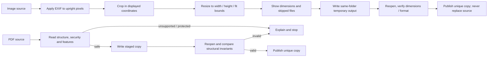

# XF-IMAGE-PDF-SAFE — shared image geometry and safe PDF editing

Owner request: 2026-10-29. Implement the seven Vietnamese requirements from the owner message in XFinder; never replace originals. This is a multi-step feature on `agent/codex-xf-image-pdf`, branched from the current XFinder Translate work (`db9d3b6`). No push.

## Findings from this checkout

- Image resizing currently exposes only a longest-edge preset. `ImageRunner.resize` decodes ImageIO index 0 with orientation transform, always re-encodes the first image as same format, and provides no crop, target width/height, upscale, size preview, or minimum-dimension notice.
- Existing image entry points: Finder Actions bulk operations (`XFinder/Views/Detail/FinderActionsDetailView.swift`), Notch/drop stack (`XFinder/Core/Notch/NotchSurfaceController.swift`, `XFinder/Views/NotchSurfaceView.swift`), Browser Preview pane Inspector actions (`XFinder/Views/Browser/InspectorImageActions.swift`, isolated worker `XFinder/Core/Browser/InspectorImageChild.swift`). Browser Preview pane itself has no image Save As/Export editor. Add the requested preview crop/save/export surface; centralize its geometry with all existing image output paths. Avoid inventing separate Optimize/Edit implementations.
- PDF tools currently provide Merge, Extract, Rotate (`PdfToolsDetailView`, `PdfRunner`). There is no PDF size reduction, page reorder, watermark, page-number or Searchable-PDF action. Notch merge and image-to-PDF use separate entry paths.
- No external PDF repair/optimization tools (qpdf, Ghostscript, MuPDF, pdftk, pdfcpu) are installed in this checkout host. SDK PDFKit write options are available: `saveImagesAsJPEG`, `optimizeImagesForScreen`, `saveTextFromOCR`; use only after validating preservation.
- Current app is macOS 14+ arm64 and Swift 6. No third-party dependency or executable can be assumed.

## Step 1 — image transforms, bulk planning and preview export

Files expected: `XFinder/Core/Image/ImageEngine.swift`, `ImageRunner.swift`, `XFinder/Core/Browser/InspectorImageChild.swift` and its pure request/rules as needed, Finder Actions and Notch image UI, Browser Preview `PreviewPaneView.swift` and `InspectorImageActions.swift`, tests/symlinks, add-only L10n script/store. A new pure `ImageTransformRules.swift` needs exactly four pbx entries and a test symlink.

Build one geometry pipeline used by Finder Actions, Notch and Browser Inspector/Preview Export:

1. Decode, apply EXIF orientation into upright pixels, then crop in displayed-image normalized coordinates, then resize. Write orientation metadata as 1 and update width/height metadata; keep applicable color profile and non-stale metadata. No consumer may crop after resizing or apply orientation a second time.
2. Resize constraints include width, height, and fit-inside bounds. Every target preserves source aspect ratio. If either oriented source dimension is smaller than the requested limit, do not upscale by default; `Phóng lớn ảnh nhỏ` is a real explicit option. Mixed batches keep per-file source dimensions, skip/report dimensions below the requested target, and continue other files.
3. Preview the calculated per-file input/output dimensions, effective crop and skips before writing. Identify the previewed source by stable identity (device/inode plus size and modification time, or content hash where file-provider identity is unavailable), not path alone. Output naming remains keep-both and never overwrites sources/existing files. A batch save applies the same immutable options snapshot to every file.
4. Add crop + resize + format + quality controls to Browser Preview Save As/Export (the current Preview pane does not have these controls); show source/output pixels before committing. Apply the same crop-before-resize pipeline as batch and Inspector paths. Multi-frame inputs must never silently become still images: preserve all frames and timing, or reject with a localized reason. Audit existing first-frame output paths including PDF assembly and Vision-child outputs and apply the same policy.
5. Empty crop, crop outside bounds, zero/negative/over-limit target, unreadable metadata, unsupported encoder, source changing between preview and write, cancellation, low-memory large image and output failure all produce a visible per-file result and leave sources untouched. If the source changes after preview, re-read identity and recalculate or refuse stale output.

Acceptance: generated EXIF orientation 1/6/8 with asymmetric pixels; landscape/portrait/square; crop + width/height/bounds; no-upscale default and enabled; 0/1 px/maximum/invalid inputs; mixed-size batch warning/continue; batch and preview pixel equality for the same options; target format with unavailable encoder; source mutation between preview and save; no partial output on failure.

## Step 2 — PDF read/recovery, structural edits and validation

Files expected: `XFinder/Core/Pdf/PdfEngine.swift`, `PdfRunner.swift`, `XFinder/Core/Image/PDFAssembler.swift`, `XFinder/Views/Detail/PdfToolsDetailView.swift`, Notch PDF action integration only where appropriate, PDF integration fixtures/tests, localized strings. Any new pure rules source requires four pbx entries and test symlink.

1. Keep inputs read-only. Write to a unique same-directory temporary file; reopen/validate it; atomically publish a keep-both final URL only after validation. Remove temp files on failure/cancel. Validate page count, page availability, page boxes/rotation, selectable text, supported annotation/widget/link inventories using PDFKit and CoreGraphics. These checks establish only the fixture properties inspected; they are not proof of arbitrary PDF semantic equivalence. The original bytes must remain identical after every operation.
2. Support only explicitly inventoried structures that can be inspected before and after rewrite. For page organization (reorder, extraction/splitting, merge and rotation), compare text, geometry, supported annotation subtypes, actionable link destinations, widget field name/type/value, and outline titles/destinations using real fixtures. Do not claim exact preservation of all unknown/custom annotations or arbitrary vector geometry. Treat AutoCAD SHX as a fixture target: first identify whether a real sample represents SHX as text/marked content, annotation data, or another structure; until characterized and passing, reject affected operations when its structure cannot be classified. Reject any uninspectable type/reference/catalog feature before final save. Rebase links/outlines only when destination mapping is known. Duplicate field names in merge are rejected until collision mapping is implemented.
3. Use a bounded recovery detector, not a general repair claim. Accept internally consistent classic-xref and xref-stream files. A recovery-copy warning may be shown only for fixture-backed recognized defects (initially missing terminal `%%EOF` or an out-of-file `startxref` offset while PDFKit and CoreGraphics both expose a complete page tree). Do not infer recoverability from successful opening or marker scans alone. If the detector cannot distinguish a supported defect from an incremental update, damaged xref stream, or unknown structure, refuse and explain recovery could not be verified. Label output “rewritten after recoverable-structure warning,” not “repaired,” unless a parser provides a reliable repair diagnostic. Rewrite only a copy and publish after reopening and checking supported invariants.
4. Respect PDF security. Fail closed for encrypted/locked inputs and restrictive permissions when credentials/policy cannot be preserved. Before mutation, inspect public CoreGraphics catalog/page dictionaries with bounded recursion (depth, object-count and cycle limits) for catalog `/Perms`, `/DocMDP`, signature fields (`/FT /Sig`), signature values (`/V` with `/Type /Sig`), and page signature widgets. Refuse when a marker is found or traversal is malformed/uninspectable. This detects signature structures; it is not cryptographic signature validation. Reject unknown catalog structures that may carry policy/navigation data. Never emit a rewrite that invalidates a detected signature.

Acceptance fixture matrix includes readable text/vector samples, external/internal links, outline destination, populated text widget, known annotation subtypes, a real AutoCAD SHX sample if available, custom page boxes/rotation, duplicate widget fields in merge, encrypted/locked and visible/invisible signed/certified PDFs, classic xref, xref-stream, supported missing-EOF and out-of-range-startxref cases with readable page tree, valid incremental update, malformed/unreadable bytes, malformed range, write failure and cancellation. Assert only observable fixture invariants: selectable/searchable text, rendered appearance within tolerance, page geometry, supported annotation/widget/link/outline inventories and destinations, unchanged source hash, and fail-closed behavior. For a fixture whose vectors are claimed preserved, canonicalize and compare before/after the ordered content-stream operator sequence and operands (including path construction/painting, text, graphics-state and transform operators); recursively include Form XObjects and their resources, and compare referenced image XObject inventories separately. The accepted sequence must contain the complete original sequence in order; added watermark/page-number drawing is allowed only as a separately identified appended sequence. If filters/resources/operators cannot be decoded, if original sequence cannot be isolated, or if pages are replaced by raster images, refuse and make no vector-preservation claim. This is fixture-scoped evidence, not a proof for arbitrary PDFs. Unknown annotation payload equality is not an acceptance claim unless a parser can inspect and compare that exact payload. Unsupported or uninspectable structures must produce no final output.

## Step 3 — size reduction, watermark, page numbers and searchable PDF

Use native PDFKit write operations only when the installed SDK/OS actually supports them. PDFKit documents `saveImagesAsJPEG`, `optimizeImagesForScreen`, and `saveTextFromOCR`; these can keep PDF page content rather than replacing complete pages with rendered images. Do not set `burnInAnnotations`. Do not use page-sized rasterization for reduction, watermark or pagination.

- Reduce Size: disclose that JPEG/screen optimization can recompress or downsample embedded images (lossy quality trade-off). Make a staged copy with image options; never rasterize full pages. Validate supported text, content-stream evidence, annotations/forms/links and protection as in Step 2. Compare actual bytes after validation; publish only if strictly smaller, otherwise delete staging output and report no smaller copy.
- Watermark and Page Numbers: add a separate vector/text content layer, not a rasterized page. Validate original text, supported content-stream evidence and annotation interactivity. Place relative to each page's crop box/rotation; handle mixed page sizes. Refuse protected/signed/unknown pages if supported preservation cannot be established.
- Searchable PDF: offer native PDFKit OCR on pages lacking a text layer, writing invisible selectable OCR text. Existing text must remain. Do not claim reading-order fidelity absent fixture evidence; report only that recognized text is searchable. Cancelled, unsupported OS, no text recognized, malformed source or no result must not replace or emit a misleading file.

Acceptance: vector + selectable text + embedded raster fixture; compare page render and text selection before/after reduce-size, apply the canonical content-stream comparison above and compare supported links/forms/annotations, and publish only if the file shrinks strictly. Watermark/page numbers remain selectable/vector on portrait/landscape/rotated/CropBox-offset fixtures without hiding content; the original canonical stream sequence remains intact and the overlay is an additional appended sequence; preserve supported interactions. Searchable scan fixture adds text discoverable with `PDFDocument.findString`, keeps page rendering and supported links/forms; mixed text+scan does not duplicate existing OCR text. macOS 14 baseline must compile with availability checks; confirm installed OS behavior for each option.

## Shared failure and privacy cases

No files, oversized input, source disappears/changes after preview, corrupt/unsupported input, no encoder/recognition, encrypted or read-only permission, signature/certification, unsupported annotation/widget/link/catalog feature, duplicated form field name, unknown/invalid page tree, output collision, low disk space, cancellation mid-batch, one item fails while others succeed, file-provider/iCloud placeholder not downloaded, all images below target, batch mixes EXIF orientations, user disables or declines operation. Do not mutate any original, log document text/metadata or cache extracted OCR. Never report a repaired/optimized/smaller result without reopening and measuring the actual output.

## Implementation process

Three commits on one branch, one per step. Each step builds/tests/gates before the next. Run the image/PDF feature tests plus `gate-all.sh`; include meaningful mutation checks for orientation/crop ordering, no-upscale, original-source preservation, output validation/rejection, and no-smaller-output behavior. New UI strings are Vietnamese L10n keys added with an add-only script. Report build, tests and installed live tests separately. If Apple PDFKit cannot round-trip one requested structure, reject the combination with visible explanation; do not relax validation to claim success.

## Primary sources and capability evidence

- Xcode macOS SDK `PDFDocument.h` in this workspace: `PDFDocumentSaveImagesAsJPEGOption`, `PDFDocumentOptimizeImagesForScreenOption` (macOS 13.4+) and `PDFDocumentSaveTextFromOCROption` (macOS 13+) are write options; `PDFDocumentBurnInAnnotationsOption` is explicitly excluded.
- Apple PDFKit `PDFDocument` read and security APIs: `permissionsStatus`, `accessPermissions`, `isEncrypted`, `isLocked`, and `allowsDocumentAssembly`/`allowsCommenting`/`allowsFormFieldEntry`.
- Apple PDFKit `PDFAnnotation` exposes action/destination and widget values; `PDFPage`/`PDFDocument` expose page and outline navigation. Any preservation claim must be demonstrated with real output fixtures, not inferred from method availability.
- Apple `Adding Custom Graphics to a PDF` and `Adding Widgets to a PDF Document`: https://developer.apple.com/documentation/pdfkit/adding-custom-graphics-to-a-pdf and https://developer.apple.com/documentation/pdfkit/adding-widgets-to-a-pdf-document
- Apple PDFKit unlock/permission docs: https://developer.apple.com/documentation/pdfkit/pdfdocument/unlock%28withpassword%3A%29 and https://developer.apple.com/documentation/pdfkit/pdfdocument/permissionsstatus

## Independent review required before coding

Review this spec against current source/API availability. Identify any non-testable preservation promise or unsupported security/signature behavior. Owner explicitly authorized the requested functionality; update this file with confirmed trade-offs before implementation if code/API evidence contradicts an acceptance statement.

### Independent review findings and resolution (2026-10-29)

Read-only review identified four blockers: PDFKit does not prove arbitrary annotation/catalog round-trips or vector geometry; visible signature widgets do not detect all signature/DocMDP policy; marker scans are not a general repair classifier; and rendered/text comparisons do not prove vector or reading-order fidelity. It also flagged first-frame output paths, path-only preview identity, and an underspecified vector check. This revision narrows preservation claims to inspectable fixture properties, adds bounded CoreGraphics catalog/signature-structure inspection with fail-closed behavior, limits recovery to fixture-backed defects without a general “repaired” claim, defines ordered before/after content-stream comparison (including recursive Form XObjects) as fixture-scoped vector evidence, and adds stable image identity plus a preserve-or-reject animation policy. SHX support remains conditional on obtaining and characterizing a real fixture. The reviewer made no edits and ran no tests/builds.

## Data flow contract

